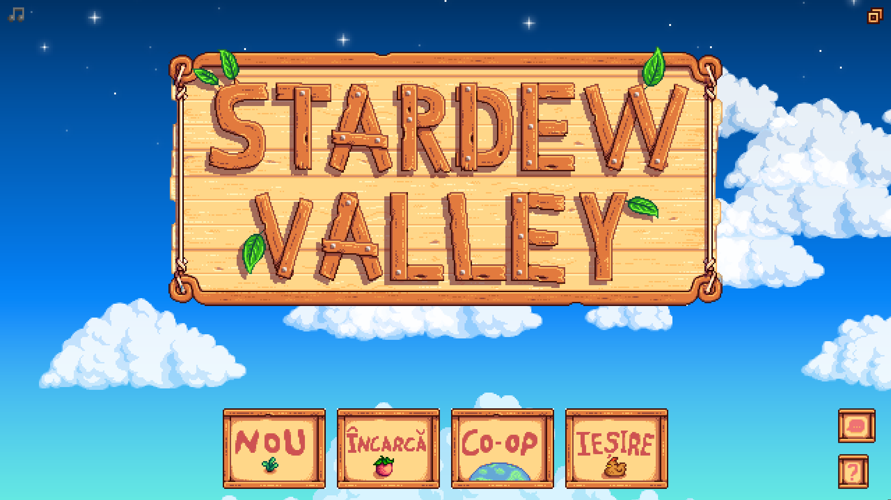
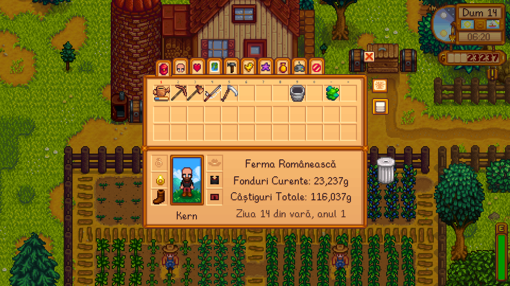
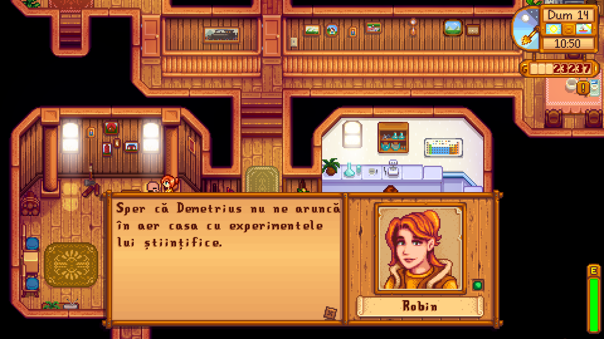
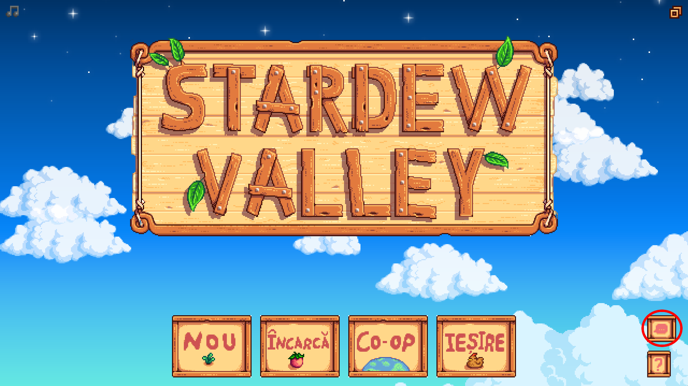
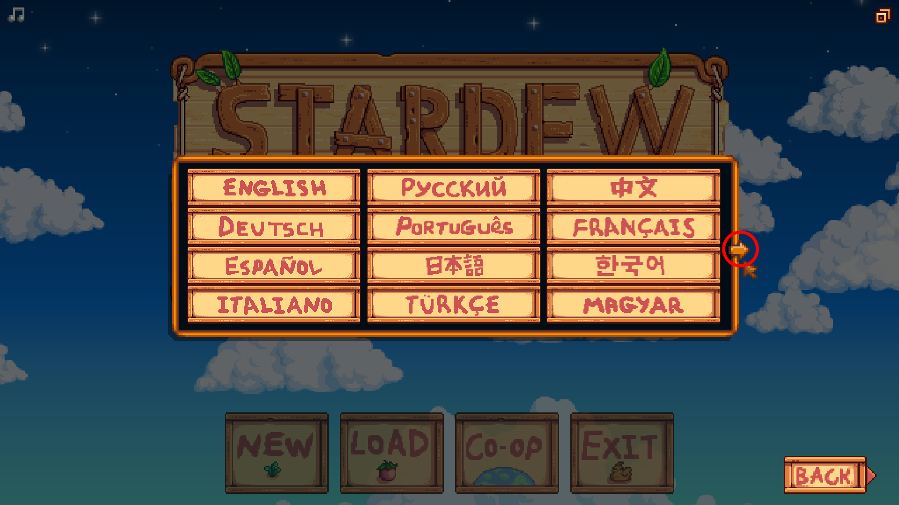
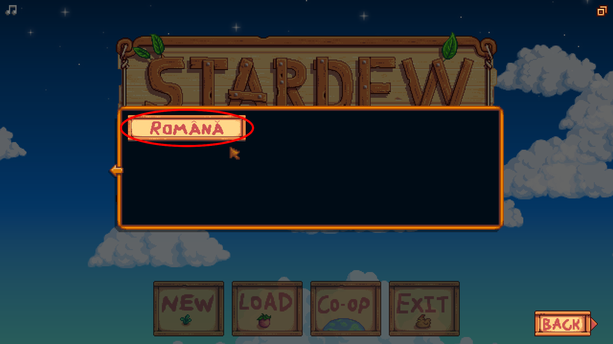

# Stardew Valley: Romanian Language Mod

Adds **"Română"** as a selectable language on Stardew Valley's title screen language menu, using a Romanian translation of the game's dialogue, data, and string assets.

## About

Stardew Valley does not ship an official Romanian translation. This mod adds one as a new entry in `Data/AdditionalLanguages`, the same mechanism the base game uses for German, Turkish, and other supported languages. Once installed, "Română" appears as its own button on the language selection screen, right alongside the vanilla languages.

The mod is split into two parts that ship together and depend on each other:

- **`[CP] Romanian Translation`**, a [Content Patcher](https://www.nexusmods.com/stardewvalley/mods/1915) content pack. It registers the new language and loads the Romanian text, data, and image files whenever that language is selected.
- **`[Harmony] Romanian Font Fix`**, a small SMAPI code mod. The Romanian alphabet needs six diacritic characters (ă, Ă, ș, Ș, ț, Ț) that the base game's fonts cannot draw. This mod patches the game's fonts at runtime so those characters render correctly. See "How it works" below for details.

## Disclaimer

This is not a professional translation and not a professional mod. It is a personal project by someone learning Romanian, who translated the game with the help of large language models and wrote this mod to make that translation playable. There is no guarantee that the translation is accurate or natural, and no guarantee that the mod runs without issues. Use it at your own risk, and please report anything that looks wrong or breaks.

## Preview

| Title screen | Item tooltip and save info | Dialogue |
| --- | --- | --- |
|  |  |  |

## Requirements

- Stardew Valley, installed with [SMAPI](https://smapi.io/) (the mod loader).
- [Content Patcher](https://www.nexusmods.com/stardewvalley/mods/1915), installed as its own mod.
- Both parts of this mod, `Romanian Translation` and `Romanian Font Fix`. Neither works without the other.

## Installing the mod

1. Install SMAPI if you have not already, following the instructions on [smapi.io](https://smapi.io/).
2. Install Content Patcher from Nexus Mods into your Stardew Valley `Mods` folder.
3. Download the latest release of this mod, or build it yourself (see "Building from source" below).
4. Copy both mod folders, `[CP] Romanian Translation` and `RomanianFontFix`, into your Stardew Valley `Mods` folder.
5. Launch the game through SMAPI. On the title screen, open the language menu and select "Română".

### Selecting "Română" in-game

Once the game is running, switch the language from the title screen. It only takes a few clicks.

1. On the title screen, click the language button in the bottom right corner, circled in red below.

   

2. The language menu opens showing the vanilla languages. "Română" is on the next page, so click the arrow on the right edge of the menu, circled in red below, to page forward.

   

3. The second page shows a single option, "Română". Click it.

   

4. The title screen, its buttons, and the rest of the game now display in Romanian.

   

## Building from source

The content pack needs no build step; it is plain JSON and image files that SMAPI reads directly. Only the font fix needs to be compiled. In both cases, install the [.NET SDK](https://dotnet.microsoft.com/) (net6.0 target) first.

### Linux

1. Build `mod/[Harmony] Romanian Font Fix/` in Release mode:
   ```bash
   cd "mod/[Harmony] Romanian Font Fix"
   dotnet build -c Release
   ```
   This project uses [SMAPI's mod build package](https://www.nuget.org/packages/Pathoschild.Stardew.ModBuildConfig), which automatically copies the built mod into your Stardew Valley `Mods` folder and produces a release zip, as long as the game is installed at the path set by the `GamePath` property in `RomanianFontFix.csproj`. That property is currently set to a local Steam library path and will need to be changed to match your own installation, for example `~/.steam/steam/steamapps/common/Stardew Valley` or wherever your Steam library lives. You can either edit `GamePath` in the `.csproj` directly, or override it on the command line without editing the file:
   ```bash
   dotnet build -c Release -p:GamePath="/home/yourname/.steam/steam/steamapps/common/Stardew Valley"
   ```
2. Copy the whole `mod/[CP] Romanian Translation/` folder into your Stardew Valley `Mods` folder as well, since it is not built automatically.
3. Launch the game through SMAPI and select "Română" from the title screen language menu.

### Windows

1. Build `mod/[Harmony] Romanian Font Fix/` in Release mode, either from a command prompt:
   ```powershell
   cd "mod\[Harmony] Romanian Font Fix"
   dotnet build -c Release
   ```
   or by opening `RomanianFontFix.csproj` in Visual Studio and building the Release configuration.

   As on Linux, [SMAPI's mod build package](https://www.nuget.org/packages/Pathoschild.Stardew.ModBuildConfig) automatically copies the built mod into your Stardew Valley `Mods` folder and produces a release zip. On Windows it can usually detect the game folder automatically through the registry or a nearby Steam or GOG install, so the `GamePath` property in `RomanianFontFix.csproj` can often be left empty or removed. If it cannot find the game, set `GamePath` explicitly, either in the `.csproj` or on the command line:
   ```powershell
   dotnet build -c Release -p:GamePath="C:\Program Files (x86)\Steam\steamapps\common\Stardew Valley"
   ```
2. Copy the whole `mod\[CP] Romanian Translation\` folder into your Stardew Valley `Mods` folder as well, since it is not built automatically.
3. Launch the game through SMAPI and select "Română" from the title screen language menu.

## Repo layout

```
.
└── mod/
    ├── [CP] Romanian Translation/    # the installable Content Patcher content pack
    │   ├── manifest.json             # SMAPI content-pack manifest
    │   ├── content.json              # generated, do not hand-edit, see below
    │   ├── assets/
    │   │   ├── button.png            # hand-drawn language-select button
    │   │   └── content_ro/           # Romanian translation files, shipped as-is
    │   └── scripts/
    │       └── generate_content_json.py  # generates content.json, see below
    └── [Harmony] Romanian Font Fix/  # C# SMAPI mod, required dependency of the content pack
        ├── manifest.json
        ├── RomanianFontFix.csproj
        ├── ModEntry.cs               # Harmony patch teaching font_bold to draw ă/Ă/ș/Ș/ț/Ț
        ├── DiacriticSpriteFontPatcher.cs
        ├── SpriteFont1Patcher.cs
        ├── SmallFontPatcher.cs
        └── assets/                  # glyph PNGs composited onto SpriteFont1/SmallFont at runtime
```

## How it works

### Registering the language

The content pack adds an entry to `Data/AdditionalLanguages`, the same native mechanism vanilla Stardew Valley uses for languages like German, Turkish, or Portuguese. That entry points at the translated files under `assets/content_ro/`, so the game loads them the moment "Română" is selected, the same way it loads any other language.

### Rendering the diacritics

Stardew Valley draws text through four independent font systems, and each one needed to be checked separately for whether it could display the Romanian diacritics ă, Ă, ș, Ș, ț, and Ț.

1. **`LooseSprites/font_bold`** (plus `font_colored`). This is the classic chunky pixel font. `StardewValley.BellsAndWhistles.SpriteText`, which draws almost all dialogue text, most menu labels, and things like the save-slot farmer name, uses this font whenever `LocalizedContentManager.CurrentLanguageLatin` is `true`. That flag is `true` for English, Spanish, German, Portuguese, French, Italian, Turkish, and Hungarian, and for a modded language it is whatever `UseLatinFont` is set to in `Data/AdditionalLanguages`. Diacritics are handled here, see below.
2. **`Fonts/SpriteFont1`** (`Game1.dialogueFont`). This is a real compiled XNA `SpriteFont`. Some menus draw directly with it, bypassing `SpriteText` entirely; for example, `LoadGameMenu` and `SaveGameMenu` use it for the farm name, in-game date, gold, and playtime on each save slot. Diacritics are handled here, see below.
3. **`Fonts/tinyFont`** (`Game1.tinyFont`). This is the same kind of compiled XNA `SpriteFont` as `SpriteFont1`, but checked against every `Game1.tinyFont` reference in the decompiled game code across `Toolbar.cs`, `InventoryMenu.cs`, and `CraftingRecipe.cs`, it turns out to be used exclusively for hotbar slot labels (1 through 9, 0, minus, equals) and numeric quantity or width measurement, never a translated string. No work was needed for this font.
4. **`Fonts/SmallFont`** (`Game1.smallFont`). This is another compiled XNA `SpriteFont`, and by far the highest traffic of the non `SpriteText` paths. `IClickableMenu.drawHoverText` and `drawToolTip` use it for the description body of every item tooltip, `FishingRod.cs` uses it for the catch and size popup, and it also backs `HUDMessage` toasts, the chat box, and several menus. Diacritics are handled here, see below.

The mod's `content.json` sets `"UseLatinFont": true`, which makes `SpriteText` use `font_bold` everywhere, so ordinary text looks pixel identical to the English version. All six Romanian diacritics render correctly through it: â and Î were already present in vanilla `font_bold`, and ă, Ă, ș, Ș, ț, and Ț were hand-drawn and composited into previously blank cells in the font atlas. Since `SpriteText.getSourceRectForChar`, the method that maps a character to its atlas cell, is hardcoded in C# rather than data-driven, teaching the game to find those six new glyphs required a small Harmony patch. That patch ships as `mod/[Harmony] Romanian Font Fix/`, a required dependency of the content pack, declared in its manifest.

The same six diacritics also render correctly on the Load and Save Game screens (`Fonts/SpriteFont1`). That font is a compiled XNA `SpriteFont`, not a plain texture, and there is no public API to add a glyph to it after the XNB has loaded. To work around this, `RomanianFontFix` hooks `Content.AssetRequested` for that asset and, on load, composites the same six hand-drawn glyphs onto the vanilla texture using a `RenderTarget2D` (needed because the vanilla texture is not in a plain `Color` format that `GetData` can read directly), then rebuilds the `SpriteFont` through its public constructor and copies its private fields onto the live instance, so every existing reference, including `Game1.dialogueFont`, sees the change immediately.

The same six diacritics also render correctly through `Fonts/SmallFont`, covering item tooltips, the fishing catch popup, HUD messages, chat, and more. It is patched the same way as `SpriteFont1`: `RomanianFontFix` hooks `Content.AssetRequested` for that asset too and runs the same composite-then-swap-private-fields logic, implemented in `SmallFontPatcher.cs` and shared with `SpriteFont1Patcher.cs` through `DiacriticSpriteFontPatcher.cs`.

## Regenerating the content pack

If any file under `mod/[CP] Romanian Translation/assets/content_ro/` changes, regenerate `content.json` to match:

```bash
cd "mod/[CP] Romanian Translation"
python3 scripts/generate_content_json.py
```

Do not hand-edit `content.json` directly; it is a generated file and will be overwritten the next time the script runs.
